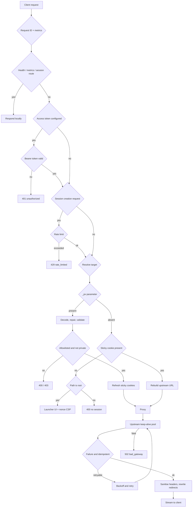

# Sticky-Session Reverse Proxy

A production-grade reverse proxy for applications and media origins you are
authorized to front. Built for Node.js 18+ / Express 4, deployed on Render.

> **Scope.** Targets are validated against an origin allowlist, and header
> sanitisation (CSP / `X-Frame-Options` / COOP / COEP removal, permissive
> CORS) applies only to those allowlisted origins. This service is intended
> for origins you own or have permission to proxy — it is not a tool for
> evading third-party bot protection, IP blacklists or access controls.

## Highlights

- **Base64 target routing** — `/?_px=<base64>` selects the upstream target.
  Padding is repaired automatically, `+`/space and base64url variants are
  accepted, and trailing query collisions (`&token=…`) are split off and
  forwarded upstream.
- **Sticky sessions** — `_px_target` (origin) and `_px_base` (entry point)
  are issued as `HttpOnly`, `SameSite=None`, `Secure` cookies with a 4-hour
  sliding expiry, so background asset, API and media requests without `_px`
  still resolve to the right upstream.
- **Pooled upstream connections** — `node-http-proxy` forces
  `Connection: close` unless an agent is supplied; this server supplies a
  protocol-aware keep-alive pool, so a page with dozens of asset requests
  reuses one upstream connection instead of handshaking per asset.
- **Consistent client fingerprint** — a browser client's own user agent,
  client hints and fetch metadata are relayed verbatim; non-browser clients
  are normalised onto a single, internally consistent Chrome profile.
- **Response sanitisation** — restrictive security headers and server
  identification headers are removed; CORS is made permissive.
- **Media streaming** — responses are piped, never buffered, so HLS playlists
  and `.ts`/`.m4s` chunks never accumulate in memory.
- **WebSockets** — upgrade requests are routed through the same resolver.
- **Redirect rewriting** — same-origin `Location` headers are rewritten back
  onto the proxy domain.
- **Resilience** — bounded retries on transient upstream failures, request
  body limits, session-creation rate limiting, SSRF containment, and a
  graceful drain on `SIGTERM`.
- **Observability** — request IDs, structured JSON logs and Prometheus
  metrics.
- **Dark-mode launcher UI** at `/` for starting a session.

## Quick start

```bash
npm install
ALLOWED_ORIGINS=https://your-origin.example npm start
```

Open `http://localhost:3000/` and enter a target URL, or navigate directly to:

```
http://localhost:3000/?_px=<base64url(target-url)>
```

Copy `.env.example` for a full local configuration reference.

## Request lifecycle



## Configuration

| Variable | Default | Purpose |
| --- | --- | --- |
| `PORT` | `3000` | HTTP port (Render sets `10000`) |
| `NODE_ENV` | — | `production` makes an empty allowlist deny every target |
| `TRUST_PROXY` | `1` | Number of trusted proxy hops used to resolve the client address. `false` disables it |
| `ALLOWED_ORIGINS` | — | Comma-separated origins: `https://example.com`, `example.com`, `*.example.com`, `user:pass@example.com`, `*` |
| `STRIP_SECURITY_HEADERS_ORIGINS` | `ALLOWED_ORIGINS` | Origins for which CSP/XFO/COOP/COEP are removed |
| `PROXY_ACCESS_TOKEN` | — | Optional bearer token required in front of the proxy |
| `PROXY_ACCESS_USER` | — | Optional HTTP Basic user (browser-native authentication prompt) |
| `PROXY_ACCESS_PASSWORD` | — | Password for the Basic user |
| `ENABLE_CORS` | `true` | Emit permissive CORS headers |
| `PUBLIC_ORIGIN` | derived from `Host` | Origin used when rewriting redirects |
| `EXAMPLE_TARGET` | — | Target pre-filled in the launcher UI |
| `MAX_BODY_BYTES` | `10485760` | Maximum proxied request body size |
| `RATE_LIMIT_MAX` | `30` | Session creations allowed per client per window |
| `RATE_LIMIT_WINDOW_MS` | `60000` | Rate limit window |
| `UPSTREAM_MAX_SOCKETS` | `64` | Concurrent upstream sockets per host |
| `UPSTREAM_KEEPALIVE_MS` | `30000` | Upstream keep-alive idle timeout |
| `RETRY_ATTEMPTS` | `2` | Retries for idempotent requests after a transient failure |
| `RETRY_BASE_DELAY_MS` | `100` | Base backoff, doubled per attempt with jitter |
| `SSRF_GUARD` | `true` | Block targets that resolve to private addresses |
| `ALLOW_PRIVATE_TARGETS` | `false` | Permit private/internal origins |
| `DNS_CACHE_TTL_MS` | `60000` | TTL for SSRF resolution verdicts |
| `MAX_TARGET_LENGTH` | `4096` | Maximum accepted `_px` payload length |
| `LOG_LEVEL` | `info` | `error`, `warn`, `info` or `debug` |
| `LOG_FORMAT` | `json` | `json` or `pretty` |
| `SHUTDOWN_GRACE_MS` | `20000` | Drain budget after `SIGTERM` |
| `FORWARDED_HEADERS` | `false` | Emit `X-Forwarded-*` upstream |
| `FORWARD_REQUEST_ID` | `false` | Relay the correlation id upstream |
| `OVERRIDE_FINGERPRINT` | `false` | Always replace the client fingerprint with the built-in profile |
| `STRIP_ACCEPT_ENCODING` | `false` | Drop `accept-encoding` instead of relaying the client's negotiation |
| `ORIGIN_HEADERS_MODE` | `relay` | `relay`, `always` or `never` — how `Origin`/`Referer` are handled |

## Endpoints

| Route | Purpose |
| --- | --- |
| `GET /` | Launcher UI (no session) or the proxied target (active session) |
| `GET /?_px=<base64>` | Opens or re-points a sticky session |
| `GET /healthz` | Liveness probe — always reachable, even behind authentication |
| `GET /readyz` | Readiness probe — `503` when the allowlist is empty in production |
| `GET /metrics` | Prometheus text exposition (requires authentication when configured) |
| `GET /_px/session` | Current sticky session summary |
| `GET /_px/new` | Clears the sticky session and returns to the launcher |
| `GET /favicon.ico` | Inline SVG icon |

## Behaviour notes

**Path mapping.** Proxy paths map 1:1 onto upstream paths, so relative asset
URLs, redirects and playlists resolve identically on both sides. When the
target contains a base path (`https://origin.example/app`), the entry request
is answered with a canonical `302` onto `/app`, keeping the `_px` payload so
the redirect stays self-resolving.

**Cookies.** `_px_target` holds the upstream origin, `_px_base` the entry
point. Both are `HttpOnly`, `Path=/`, `Max-Age=14400`, and `SameSite=None;
Secure` over TLS (`SameSite=Lax` without TLS, since browsers reject
`SameSite=None` without `Secure`). They are stripped from the request before
it reaches the upstream, and upstream `Set-Cookie` headers have their
`Domain` attribute removed so they work on the proxy domain.

**CORS.** The caller's `Origin` is echoed with `Allow-Credentials` when
present, falling back to `*`. A literal wildcard would break cookie-bearing
fetches, which would undermine the sticky-session design.

**Compression.** `accept-encoding` is relayed by default, so the upstream
responds exactly as it would for the original client. Bodies are streamed
untouched, so the `content-encoding` always matches what the client asked
for. Set `STRIP_ACCEPT_ENCODING=true` to disable upstream compression.

**Retries.** `GET`, `HEAD` and `OPTIONS` are retried after transient
connection failures (`ECONNRESET`, `ETIMEDOUT`, …) with jittered exponential
backoff. Requests with bodies are never retried.

**Client identification.** `TRUST_PROXY` is a *hop count*, not a boolean.
With one trusted edge in front (Render), `TRUST_PROXY=1` makes the proxy read
the address that edge appended to `X-Forwarded-For`, so a client cannot move
its own rate-limit bucket by prepending a forged entry. Trusting every hop
(`true`) would read the client-controlled left-most entry instead. The
bucket key is also normalised across address formats, so `127.0.0.1` and
`::ffff:127.0.0.1` are the same client.

**Response fidelity.** The upstream's own `Vary` header is preserved and
extended rather than replaced, so caching semantics survive the hop. Upstream
cookies keep working on the proxy domain: their `Domain` attribute is
removed, and `Secure` is dropped only when the client connection is not TLS
(a browser discards such cookies outright).

## Signal fidelity

A proxy is easiest to spot when it contradicts the client it forwards for.
The default behaviour is therefore **relay, don't fabricate**:

| Signal | Behaviour | Why |
| --- | --- | --- |
| `User-Agent`, client hints | Relayed for browser clients; non-browser clients (scripts, crawlers, CLIs) are normalised onto the built-in profile | A browser's own fingerprint is self-consistent; overwriting it with a *different* fixed profile (Chrome 131/Windows over a Chrome 140/macOS client) creates a contradiction that is a stronger tell than either version |
| `Accept`, `Accept-Language` | Relayed with the fingerprint, as a set | A Chrome identity paired with `accept-language: *` is as inconsistent as the reverse |
| `Origin`, `Referer` | Relayed only when the client sent one, rewritten onto the upstream origin | Browsers omit `Origin` on navigation; injecting one is a deviation. A `Referer` pointing at the proxy domain would disclose the proxy outright |
| `Sec-Fetch-*` | Relayed untouched | These describe the real request and are correct as sent |
| `X-Forwarded-*`, `Forwarded`, `X-Real-IP` | Dropped, inbound and outbound | A clear proxy tell, and inbound copies would let a client spoof its address upstream |
| `x-request-id` | Kept local | A correlation id is not something a browser sends |
| `Host` | Rewritten to the upstream | Required for the upstream to route the request correctly |
| `Via`, hop-by-hop headers | Dropped | Protocol requirements |

Set `OVERRIDE_FINGERPRINT=true` to always present the built-in profile, or
`FORWARDED_HEADERS=true` when the upstream genuinely needs the client chain.

### What this cannot hide

The HTTP layer is now as faithful as this engine allows. The remaining
signals are below it, and they dominate real-world bot scoring:

1. **TLS fingerprint (JA3/JA4).** Node's `ClientHello` differs from Chrome's
   in cipher order, extensions and ALPN. Masking this requires a
   browser-impersonating TLS stack (`curl-impersonate`-style tooling), which
   is deliberately out of scope here.
2. **HTTP/2.** The upstream connection is HTTP/1.1; `http-proxy-middleware`
   has no h2 support, so h2-specific framing and HPACK details are absent.
3. **Network reputation.** The upstream sees the proxy's egress IP and ASN.
   A datacentre address on a shared cloud range is frequently the decisive
   signal, and no header can change it — only a residential or dedicated
   egress can.
4. **Behaviour.** Request ordering, timing and session continuity are
   observable at the application layer.

Items 1–3 mean "undetectable" is not achievable from inside an application
process. This configuration removes everything that is removable without
impersonating a browser's network stack, which is the line this service
draws.

## Failure modes

| Situation | Response |
| --- | --- |
| Missing or undecodable `_px` payload | `400 bad_request` |
| Target outside `ALLOWED_ORIGINS` | `403 forbidden` |
| Target resolves to a private address | `403 forbidden` |
| No sticky session for a non-root path | `400 bad_request` |
| Too many sessions from one client | `429 rate_limited` |
| Request body over `MAX_BODY_BYTES` | `413 payload_too_large` |
| Missing or invalid access token | `401 unauthorized` |
| Upstream unreachable or failing | `502 bad_gateway` |

None of these terminate the process: `uncaughtException` and
`unhandledRejection` are logged, and the server keeps serving.

## Deployment on Render

`render.yaml` is a ready-to-use Blueprint.

1. Push the repository to GitHub or GitLab.
2. In Render: **New → Blueprint**, select the repository.
3. Set the variables declared with `sync: false` — at minimum
   `ALLOWED_ORIGINS`.
4. Deploy. The health check path is `/healthz`.

The blueprint keeps the service at a single instance because rate-limit and
session state live in process memory. To run multiple instances, move the
limiter to a shared store (for example Redis) and raise the instance count in
the Render dashboard.

## Tests

```bash
npm test
```

The suite boots a local upstream origin plus the proxy and asserts 49
behaviours across routing, sticky sessions, base64 repair, signal fidelity,
protocol correctness, header fingerprinting, response sanitisation, CORS,
redirect rewriting, streaming, WebSockets, allowlist enforcement, SSRF
containment, rate limiting, authentication, retries, connection pooling,
request bodies, range requests and the operational endpoints.

## Files

| Path | Purpose |
| --- | --- |
| `server.js` | The complete server: resolver, proxy hooks, launcher UI |
| `render.yaml` | Render Blueprint |
| `package.json` | Dependencies and scripts |
| `test/integration.js` | End-to-end integration suite |
| `.env.example` | Local configuration reference |
